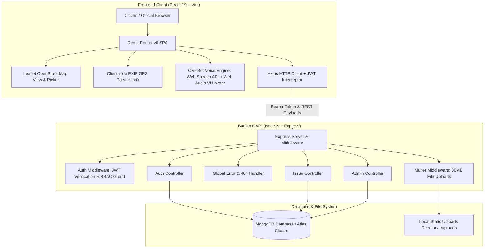

# 🏛️ CivicTrack — Civic Issue Reporting & GIS Transparency Platform

> A production-ready, full-stack **MERN** civic grievance redressal and spatial analytics platform bridging the communication divide between citizens and municipal departments.

[](https://nodejs.org/)
[](https://react.dev/)
[](https://www.mongodb.com/)
[](https://leafletjs.com/)
[](LICENSE)

---

## 📌 1. Project Overview & Problem Statement

Urban civic governance often suffers from slow turnaround times, duplicate complaints, and zero visibility into resolution progress. Common civic grievances include:
- 🛣️ **Roads:** Deep crater potholes, broken dividers, and hazardous street damage.
- 🚰 **Water Supply:** Underground pipeline bursts, contamination, and low-pressure supply.
- 🗑️ **Waste Management:** Overflowing community dumpsters and uncollected bio-waste.
- 💡 **Electricity:** Dark streetlight corridors, hanging cables, and transformer faults.

**CivicTrack** transforms urban grievance redressal into a transparent, crowdsourced ecosystem:
1. **Interactive GIS Spatial Mapping:** Built with **Leaflet** and **OpenStreetMap** for pin-point coordinate picking and city-wide cluster visualization (100% open-source, zero Google API billing or credit card requirements).
2. **EXIF Camera Photo Metadata Auto-GPS:** Client-side binary EXIF parser (`exifr`) automatically extracts embedded GPS coordinates and capture timestamps from smartphone photos, reverse-geocodes street addresses via Nominatim, and auto-positions the map pin.
3. **CivicBot Municipal AI & Voice Assistant:** 24/7 intelligent municipal chatbot featuring Web Speech STT with continuous listening, real-time live transcription, silence debouncing, hardware microphone switcher with animated VU meter, and Text-To-Speech (TTS) readout.
4. **Transparent Audit Timeline:** Every complaint features an immutable state transition history (`Pending` $\rightarrow$ `In Progress` $\rightarrow$ `Resolved` $\rightarrow$ `Rejected`) recording timestamped inspector notes and acting officer IDs.
5. **Department Workflow Routing & RBAC:** Automatic department assignment (`Roads`, `Water Supply`, `Waste Management`, `Electricity`) with strict Role-Based Access Control separating Citizens from Municipal Officials and Admins.
6. **Community Upvoting & De-Duplication:** Citizens can upvote nearby complaints to prioritize urgent issues and eliminate duplicate municipal work tickets.
7. **High-Resolution Photo Ingestion (30 MB):** Multer pipeline supporting modern high-resolution smartphone photography (JPEG, PNG, WebP, HEIC/HEIF, AVIF).
8. **Cloud & Vercel Ready:** SPA client routing configurations (`vercel.json`), pre-configured seeders, and cloud database compatibility.

---

## 🏗️ 2. System Architecture



---

## 🛠️ 3. Technology Stack

| Layer | Technology | Key Capabilities & Purpose |
| :--- | :--- | :--- |
| **Frontend Framework** | **React 19 (Vite 8)** | High-speed SPA rendering, modular components, responsive UI |
| **Routing** | **React Router v6** | Client-side routing, protected auth guards, role redirection |
| **GIS Mapping** | **Leaflet + OpenStreetMap** | Color-coded markers, click-to-pin coordinate picker, zero API costs |
| **Image EXIF Parsing** | **`exifr`** | Client-side extraction of GPS Latitude/Longitude and camera metadata |
| **Voice Processing** | **Web Speech API + Web Audio API** | Continuous STT, real-time interim results, VU level meter, TTS |
| **Backend Runtime** | **Node.js (ES Modules)** | Asynchronous, event-driven RESTful API micro-services |
| **Web Framework** | **Express.js v4** | Clean MVC architecture, custom route handlers, centralized error pipeline |
| **Database & ODM** | **MongoDB & Mongoose v8** | Document schemas, embedded audit timelines, spatial coordinates |
| **Authentication** | **JWT & Bcrypt.js** | Stateless Bearer token authentication, salted password hashing |
| **File Ingestion** | **Multer** | Multipart form handling, 30MB image support, MIME validation |

---

## 📂 4. Project Directory Structure

```text
fsd/
├── backend/
│   ├── config/
│   │   └── db.js                 # MongoDB connection & error logging
│   ├── controllers/
│   │   ├── authController.js     # User registration, login, JWT generation
│   │   ├── issueController.js    # Issue CRUD, deletion, upvoting, GIS query filters
│   │   └── adminController.js    # Department triage, status transitions, analytics
│   ├── middleware/
│   │   ├── authMiddleware.js     # JWT verification & role authorization (RBAC)
│   │   └── errorMiddleware.js    # Centralized 404 and runtime error handler
│   ├── models/
│   │   ├── User.js               # Citizen & Official schemas with password hashing
│   │   └── Issue.js              # Issue schema with coordinates & statusHistory array
│   ├── routes/
│   │   ├── authRoutes.js         # /api/auth (register, login, me)
│   │   ├── issueRoutes.js        # /api/issues (CRUD, upvote, my-reports)
│   │   └── adminRoutes.js        # /api/admin (stats, status, department assign)
│   ├── uploads/                  # Uploaded grievance images served statically
│   ├── utils/
│   │   └── seeder.js             # Realistic seed data with local demo images
│   ├── .env                      # Server environment configuration
│   ├── .env.example              # Example environment template
│   ├── package.json
│   └── server.js                 # Express server bootstrap & static file routing
│
├── frontend/
│   ├── public/
│   │   └── demo/                 # Bundled offline high-resolution demo images
│   ├── src/
│   │   ├── components/
│   │   │   ├── Navbar.jsx        # Navigation bar with dynamic role buttons
│   │   │   ├── CivicChatbot.jsx  # AI Voice Municipal Assistant & VU meter
│   │   │   ├── IssueCard.jsx     # Preview card with status badges & upvotes
│   │   │   ├── MapPicker.jsx     # Leaflet map picker for pin-drop coordinate selection
│   │   │   ├── MapView.jsx       # City-wide GIS map with category color-coded pins
│   │   │   ├── ProtectedRoute.jsx# Auth guard with role-based restriction
│   │   │   └── StatusBadge.jsx   # Visual badge for status & priority
│   │   ├── context/
│   │   │   └── AuthContext.jsx   # Global user authentication state provider
│   │   ├── pages/
│   │   │   ├── Home.jsx          # Public feed, GIS map, and search/filter controls
│   │   │   ├── Login.jsx         # Sign-in with 1-Click Demo Credentials
│   │   │   ├── Register.jsx      # Citizen & Official registration form
│   │   │   ├── ReportIssue.jsx   # Grievance reporting form with EXIF auto-GPS
│   │   │   ├── IssueDetails.jsx  # Full details, audit timeline, and delete button
│   │   │   ├── MyReports.jsx     # Citizen personal grievance tracking dashboard
│   │   │   └── AdminDashboard.jsx# Department triage, analytics, and status updates
│   │   ├── services/
│   │   │   └── api.js            # Axios client with JWT interceptor & getImageUrl()
│   │   ├── utils/
│   │   │   └── civicKnowledge.js # Municipal NLP intent engine, SLAs & helplines
│   │   ├── App.jsx               # Application routing layout & global CivicBot
│   │   ├── index.css             # Design system, responsive layouts & animations
│   │   └── main.jsx              # React DOM entry point
│   ├── .env.example              # Frontend environment template
│   ├── vercel.json               # SPA client routing rewrite rules for Vercel
│   ├── package.json
│   └── vite.config.js            # Vite build config with /uploads proxy
│
├── demo/                         # Source high-resolution sample complaint assets
├── documentation.md              # Exhaustive technical reference & architectural guide
└── package.json                  # Root monorepo workspace scripts
```

---

## ⚡ 5. Key Feature Highlights

### 📍 1. EXIF Photo Metadata Auto-GPS Detection
When reporting an issue, citizens can upload camera photos taken on their mobile devices:
- **Client-Side Extraction:** Uses `exifr` to extract embedded TIFF/XMP metadata, GPS Latitude, Longitude, Altitude, and Timestamp directly in the browser without server overhead.
- **Robust Coordinate Parsing:** Supports direct floating-point degrees, raw DMS (Degrees, Minutes, Seconds) with N/S/E/W hemisphere reference vectors, and XMP camera tags.
- **Instant Map Centering:** Immediately moves the Leaflet map pin to the exact location where the photo was taken.
- **Reverse Geocoding:** Queries the OpenStreetMap Nominatim API to automatically populate the street address and landmark field.
- **Graceful Diagnostic Feedback:** If an image has location stripped (e.g., downloaded from WhatsApp or social media), it provides user diagnostics while allowing manual click-to-pin on the map.

### 🤖 2. CivicBot AI Assistant & Hardware Voice Engine
A floating municipal AI assistant available on every page:
- **Continuous Speech Recognition:** Solves the Chromium 1-second auto-stop bug using continuous recognition, session auto-restarts, and a multi-turn transcript accumulator (`baseTranscriptRef`).
- **Real-Time Live Preview:** Displays interim speech text live as words are spoken.
- **Silence Debounce (Auto-Send):** Automatically finalizes and dispatches the query after a natural 2.2-second pause.
- **Hardware Microphone Switcher:** Uses `navigator.mediaDevices.enumerateDevices()` to detect all connected audio input hardware and lets users switch between internal, headset, and USB microphones.
- **Live VU Audio Level Meter:** Employs Web Audio API (`AudioContext` + `AnalyserNode`) to display a real-time reactive volume level bar (*Receiving Voice 🔊* vs *Quiet 🔇*).
- **Dialect & Accent Selector:** Switch between English (US), English (India), English (UK), Hindi, Tamil, Telugu, and Kannada.
- **Offline / Brave Fallback:** Detects network errors (e.g. Brave blocking Google speech APIs, firewalls) and provides a 1-click **Windows Voice Typing (<kbd>Win</kbd> + <kbd>H</kbd>)** dictation shortcut.
- **Text-To-Speech (TTS):** Spoken auditory feedback via `SpeechSynthesis` with markdown stripping and toggle controls.

### 🗺️ 3. Leaflet GIS Mapping & Spatial Visualization
- **City-Wide View:** Browse all reported issues across the city with custom color-coded category pins:
  - 🔵 **Roads** (Blue) | 🟢 **Water Supply** (Cyan) | 🟠 **Waste Management** (Orange) | 🟡 **Electricity** (Amber)
- **Interactive Pin-Drop Picker:** Citizens can click anywhere on the map or drag the marker to pinpoint exact coordinates down to 6 decimal places (~0.1 meter accuracy).
- **OpenStreetMap Tiles:** Fast, lightweight, open-source cartography with zero API fees or billing lock-in.

### ⏱️ 4. Immutable Audit Timeline & Status Workflow
- Each complaint follows a strict lifecycle: `Pending` $\rightarrow$ `In Progress` $\rightarrow$ `Resolved` (or `Rejected`).
- Every update appends an immutable entry to `statusHistory` containing:
  - Status name
  - Timestamp
  - Official's name and assigned department
  - Action / resolution remarks
- Displayed as a chronological progress stepper in `IssueDetails.jsx`.

### 🛡️ 5. Role-Based Access Control (RBAC) & Dedicated Dashboards
- **Citizens:** Can report issues, view city map, upvote community issues, manage personal complaints under *My Reports*, and delete their own unresolved complaints.
- **Municipal Officials:** Restricted from reporting issues; automatically directed to `AdminDashboard` filtered to their specific department (`Roads`, `Water Supply`, `Waste Management`, `Electricity`). Can update statuses and add resolution comments.
- **Super Admin:** System-wide visibility, departmental reassignments, global analytics, and issue deletion.

### 🗑️ 6. Issue Deletion & Storage Lifecycle
- Citizens can delete their own complaints; Admins can delete any ticket.
- Backend unlinks and permanently deletes the uploaded image from the server disk (`uploads/`), preventing orphaned files.

### ⚡ 7. 1-Click Demo Credentials
- Instant login buttons on [`Login.jsx`](file:///d:/fsd/frontend/src/pages/Login.jsx) for instant evaluation across 5 distinct roles:
  - 👤 **Citizen:** Rahul Sharma
  - 🛣️ **Roads Official:** Eng. Vikram Rao
  - 🚰 **Water Official:** Sunil Verma
  - 🗑️ **Waste Official:** Pooja Iyer
  - 🏛️ **Super Admin:** Chief Municipal Officer

---

## 🚀 6. Local Installation & Setup

### Prerequisites
- **Node.js**: v18.x or higher
- **MongoDB**: Local MongoDB community server (port 27017) OR a free [MongoDB Atlas](https://www.mongodb.com/atlas) connection URI.

### Step 1: Clone & Navigate
```bash
git clone https://github.com/R-Nikhil-Ganesh/CivicTrack.git
cd CivicTrack
```

### Step 2: Install Dependencies
```bash
# Install root, backend, and frontend packages in one command
npm run install:all
```

### Step 3: Configure Environment
Verify or update `backend/.env`:
```env
PORT=5000
NODE_ENV=development
MONGO_URI=mongodb://127.0.0.1:27017/civictrack
JWT_SECRET=civictrack_production_jwt_secret_key_2026_secured
JWT_EXPIRE=30d
CLIENT_URL=http://localhost:5173
```
*(If using MongoDB Atlas, replace `MONGO_URI` with your `mongodb+srv://...` URI).*

### Step 4: Seed Sample Data
Populate realistic civic complaints with local photos:
```bash
npm run seed
```

### Step 5: Start the Development Servers
Open two terminal windows:

**Terminal 1 (Backend API):**
```bash
npm run server
# Running on http://localhost:5000
# Health check: http://localhost:5000/api/health
```

**Terminal 2 (Frontend Client):**
```bash
npm run client
# Running on http://localhost:5173
```

### Step 6: Run Automated Test Suites
CivicTrack features an automated test suite (**87 tests**) covering backend models, RBAC authorization, REST APIs, EXIF coordinate mathematics, and CivicBot NLP intent classification:

```bash
# Run both backend and frontend test suites together (87 tests):
npm test

# Run only backend unit & integration tests (49 tests via Node native test runner + Supertest):
npm run test:backend

# Run only frontend utility & intent classifier tests (38 tests via Vitest):
npm run test:frontend
```

> **Note on Test Frameworks:** The platform deliberately employs **Vitest** (frontend) and Node's native **`node:test`** runner (backend) instead of Jest. Both natively support modern ES Modules (`"type": "module"`) and Vite without requiring Babel transpilers or experimental flags, while maintaining full Jest-compatible API syntax (`describe`, `it`, `expect`). See [`documentation.md`](documentation.md#124-architectural-justification-vitest--nodetest-vs-jest) for full architectural justification.

---

## 🔑 7. Pre-Configured Accounts & Credentials

| Role | Email | Password | Assigned Scope |
| :--- | :--- | :--- | :--- |
| **Citizen** | `citizen@civictrack.org` | `password123` | Public reporting, upvotes, *My Reports* |
| **Roads Official** | `roads@civictrack.org` | `password123` | Roads department triage & status updates |
| **Water Official** | `water@civictrack.org` | `password123` | Water supply complaint management |
| **Waste Official** | `waste@civictrack.org` | `password123` | Sanitation and garbage route triage |
| **Super Admin** | `admin@civictrack.org` | `password123` | Global analytics & department reassignment |

---

## 🌐 8. Production Deployment Guide

### Architecture Recommendation
- **Frontend:** Deploy to **Vercel** (Global CDN, fast builds, automatic SSL).
- **Backend:** Deploy to **Render.com** or **Railway** (persistent Node.js container with disk storage).
- **Database:** **MongoDB Atlas** (Free M0 cloud tier).

### Deploying Frontend to Vercel
1. Import the repository in [Vercel](https://vercel.com).
2. Set **Root Directory** to `frontend`.
3. Set **Framework Preset** to `Vite`.
4. Add Environment Variable:
   - `VITE_API_URL` = `https://your-backend-api.onrender.com/api`
5. Click **Deploy**. *(The included `frontend/vercel.json` ensures all React Router routes resolve cleanly without 404 errors).*

---

## 📖 9. In-Depth Documentation

For an exhaustive technical breakdown covering system design, entity-relationship diagrams, API specs, database schemas, and use-case workflows for evaluation reports, refer to:
👉 [**`documentation.md`**](documentation.md)

---

## 📄 License
This project is licensed under the **ISC License**. Developed for modern, transparent urban governance.
